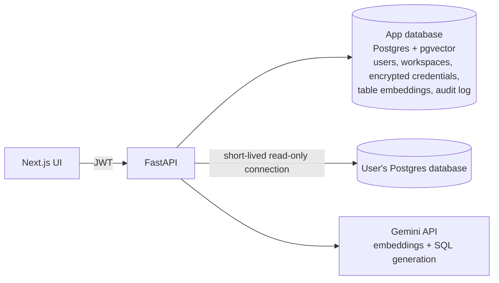
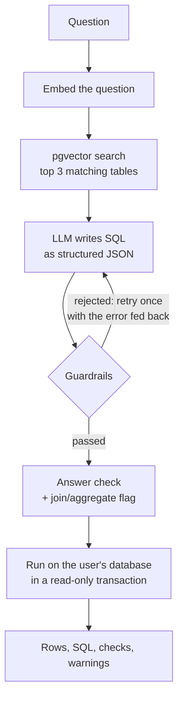

# Veriq

Ask a database a question in plain English. Veriq writes the SQL, checks it, runs it read-only, and shows you the answer along with the exact SQL and the checks that ran.

The goal is not just to generate SQL. It is to make generated SQL safe to run and easy to verify.

## What it does

- Connects to a user's own PostgreSQL database. Credentials are encrypted at rest and never returned by the API.
- Reads the schema and embeds each table's description, so a question can be matched to the right tables.
- Turns a question into SQL with an LLM, as structured JSON.
- Validates the SQL by parsing it, not by matching strings. Unsafe queries are rejected.
- Runs approved queries in a read-only transaction and returns rows, the SQL, timing, and any warnings.
- Records every attempt, including blocked ones, in an audit log.

## Architecture



### How a question is answered



The agent is a LangGraph state machine. A plain function chain cannot recover when validation fails. A state machine can route back to generation with the failure reason in the prompt.

## Safety layers

| Layer                 | What it does                                                                                                                                                   |
| --------------------- | -------------------------------------------------------------------------------------------------------------------------------------------------------------- |
| AST parsing           | SQL is parsed with sqlglot. Only a single `SELECT` is allowed. `DROP`, `DELETE`, `INSERT`, `UPDATE`, `ALTER`, `TRUNCATE`, and stacked statements are rejected. |
| Sensitive columns     | `SELECT *` is rejected. Columns whose names contain `password`, `secret`, `token`, or `encrypted_` cannot be selected.                                         |
| Complexity limit      | Queries with more than 4 joins are rejected.                                                                                                                   |
| Row limit             | A `LIMIT 1000` is added when the query has none.                                                                                                               |
| Read-only transaction | Queries run after `SET TRANSACTION READ ONLY`, so the database refuses writes even if every check above failed.                                                |
| Credential encryption | Database passwords are encrypted with Fernet before storage. They are decrypted only in memory, for the duration of a request.                                 |
| Audit log             | Every question, generated SQL, and block reason is stored.                                                                                                     |

The parser is used instead of string matching because string checks are easy to get around (mixed case, comments, keywords inside literals). A parser knows what kind of statement it is looking at.

## Design decisions

- **One embedding per table, not per column.** Retrieval needs to answer "which tables are relevant", and a table description carries meaning that a lone column name does not.
- **Different embedding task types for documents and queries.** Schema text is embedded as `retrieval_document` and the question as `retrieval_query`.
- **The connection is tested before it is saved.** A stored connection always worked at least once.
- **Encryption for database credentials, hashing for login passwords.** Veriq must reuse the database password, so it has to be reversible. Login passwords are only compared, so they use bcrypt.
- **Structured output.** The LLM must return JSON matching a Pydantic model. Anything else counts as a failed attempt.

## Tech stack

- **Backend:** FastAPI, SQLAlchemy, PostgreSQL with pgvector, LangGraph, sqlglot, bcrypt, python-jose, cryptography (Fernet)
- **LLM:** Gemini (SQL generation and answer check) and `gemini-embedding-001` (768 dimensions)
- **Frontend:** Next.js 14 (App Router), plain JavaScript and CSS
- **Infrastructure:** Docker Compose

## Quickstart

Requires Docker and Node.js 18+.

**1. Configure.** Create `backend/.env` (also saved as `backend/.env.example`):

```
JWT_SECRET=replace-with-a-long-random-string
FERNET_KEY=replace-with-a-generated-key
GEMINI_API_KEY=your-gemini-api-key
```

Generate a Fernet key with:

```
pip install cryptography
python -c "from cryptography.fernet import Fernet; print(Fernet.generate_key().decode())"
```

**2. Start the backend and databases.**

```
docker compose up --build
```

The API is at http://localhost:8000 and the interactive docs at http://localhost:8000/docs.

**3. Create the sample database** (an e-commerce schema with customers, products, orders, and order items):

```
docker compose exec postgres psql -U veriq -d veriq -c "CREATE DATABASE demo_ecommerce;"
docker compose cp backend/seed_demo.sql postgres:/seed_demo.sql
docker compose exec postgres psql -U veriq -d demo_ecommerce -f /seed_demo.sql
```

Create a read-only role for Veriq to use:

```
docker compose exec postgres psql -U veriq -d demo_ecommerce -c "CREATE ROLE veriq_readonly LOGIN PASSWORD 'readonly_dev_pw'; GRANT CONNECT ON DATABASE demo_ecommerce TO veriq_readonly; GRANT USAGE ON SCHEMA public TO veriq_readonly; GRANT SELECT ON ALL TABLES IN SCHEMA public TO veriq_readonly;"
```

**4. Register, connect, and index.** In http://localhost:8000/docs:

1. `POST /auth/register` with an email and password.
2. Click **Authorize** and log in.
3. `POST /workspace/connect-db` with host `postgres`, port `5432`, database `demo_ecommerce`, username `veriq_readonly`, password `readonly_dev_pw`.
4. `POST /workspace/generate-embeddings`.

**5. Start the frontend.**

```
cd frontend
npm install
npm run dev
```

Open http://localhost:3000, sign in, and try a sample question. Try "Show me customer payment tokens" to see a guardrail block it.

To connect your own database instead, use its host and credentials in step 4. If it runs on your own machine, use `host.docker.internal` as the host. A database user with only `SELECT` access is recommended.

## API

| Method | Path                             | Purpose                                        |
| ------ | -------------------------------- | ---------------------------------------------- |
| POST   | `/auth/register`                 | Create an account and its workspace            |
| POST   | `/auth/login`                    | Get a JWT (OAuth2 form)                        |
| GET    | `/auth/me`                       | Current user                                   |
| POST   | `/workspace/connect-db`          | Test, encrypt, and store a database connection |
| GET    | `/workspace/schema`              | Tables and columns of the connected database   |
| POST   | `/workspace/generate-embeddings` | Embed the schema for retrieval                 |
| POST   | `/workspace/relevant-tables`     | Retrieval only, for debugging                  |
| POST   | `/query/ask`                     | Question to SQL, checks, and results           |
| POST   | `/query/run`                     | Run raw SQL through the guardrails (debugging) |
| GET    | `/query/history`                 | Recent questions from the audit log            |

## Project structure

```
backend/app/
  main.py            app setup and routers
  auth.py            password hashing, JWTs, current-user dependency
  encryption.py      Fernet encryption for stored credentials
  db_utils.py        connection testing and schema introspection
  embeddings.py      Gemini embeddings (document and query modes)
  retrieval.py       pgvector similarity search
  guardrails.py      sqlglot-based SQL checks
  agent.py           LangGraph state machine
  models/ schemas/ routers/
frontend/            Next.js app
```

## Known limitations

- **Wrong-grain joins are flagged, not verified.** A join that multiplies rows can inflate a total while still being valid, read-only SQL. On the demo data, summing `orders.total_amount` after joining `order_items` returns 33,186 instead of the true 16,892. Veriq flags any query that joins and aggregates, but it does not reconcile the result against a trusted number, so it also flags safe joins.
- **The answer check is another LLM call.** It reviews whether the SQL matches the question, and it can be wrong. If it errors, it fails open.
- **Business meaning is not understood.** "Total revenue" currently includes cancelled and pending orders. Neither check catches that.
- **No automated tests or evaluation set yet.**
- **PostgreSQL only.** The connection code and the SQL parser use the Postgres dialect. Each question uses two or three Gemini calls, so free-tier quotas run out quickly.
- **One workspace per user,** and the "connect your own database" form in the UI is a locked preview. Connecting is done through the API.
- **Not hardened for public hosting.** CORS allows all origins by default, the development database password is in `docker-compose.yml`, and accepting arbitrary database hosts from strangers would need network restrictions.

## If I continued

1. Reconcile aggregates against an independently computed number, and check row counts and key uniqueness around each join.
2. Build a golden question set and report accuracy, plus how many unsafe attempts are blocked.
3. Add column-level retrieval for wide schemas.
4. Add automated tests for the guardrails.
